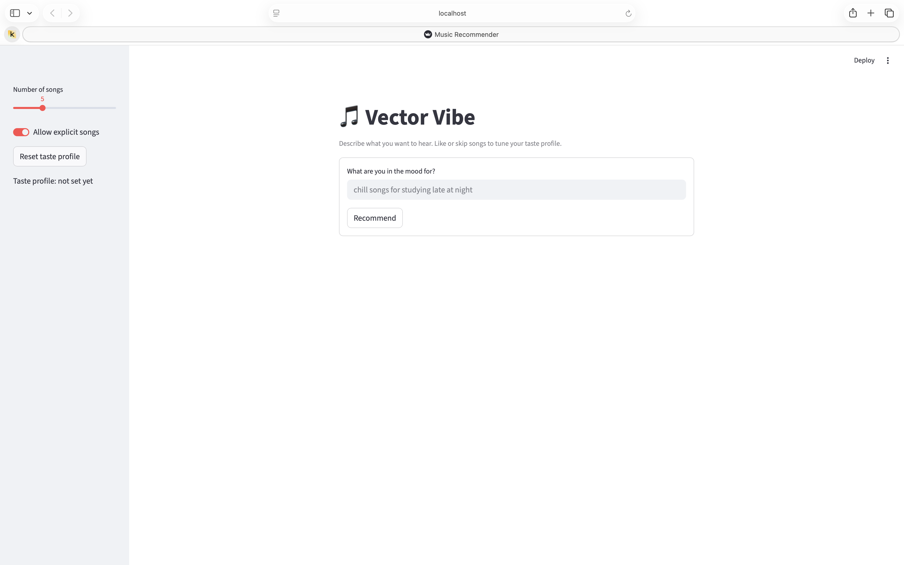
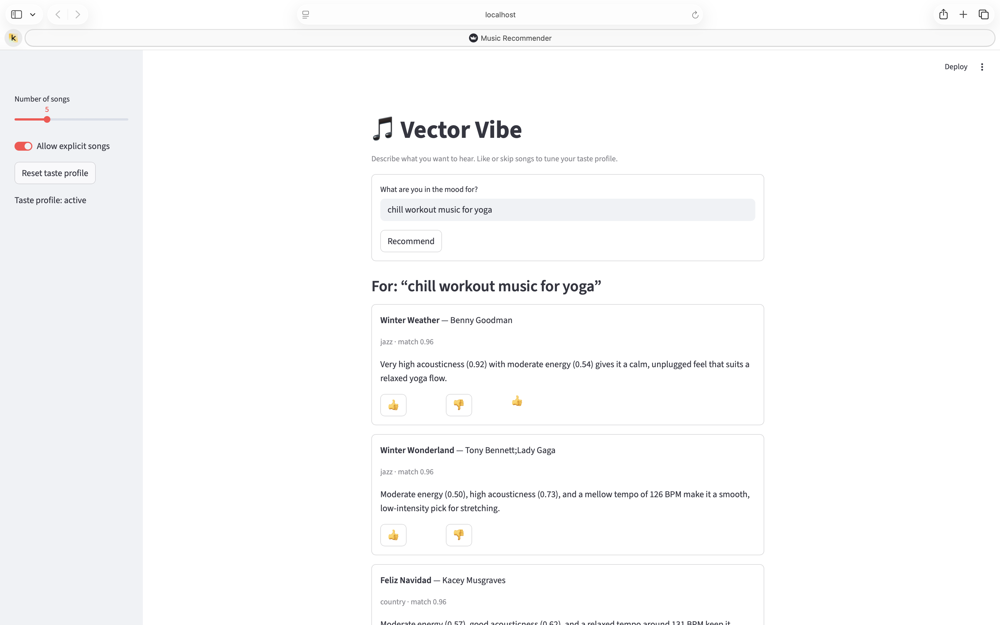

# Original Project Title and Summary 

Audiohead Vibes, the initail music recommender systems goal was to recommend music to a user. The way it worked was it recommended songs based on a user's preferences. The songs were ranked by score based on how well it matched the user's prefences. The top five songs with the highest scores were listed. 

# Title (updated music recommender system)

Vector Vibes

This system uses Retrival-Augmented Generation (RAG) to recommend music from a user's text input. The system takes that query into audio features (energy, danceability, mood, valence, acoustocness, tempo, loudness and genre). The system then checks that these values are in the dataset and transforms them into a target vector.

Then the system compares the target vector to the songs across 10 geners using consine similarity. The 10 closest matches are returned back to Claude. Claude then picks the best songs from those 10 and gives a reason for each based on the song data. By default, the app shows 5 songs. 

The result is returned as a song card in a Streamlit app. A user can like (👍) or skip (👎) a song. Each click updates the user's taste profile, moving it toward songs they like and away from songs they skip.  

# Architecture Overview

The diagram is a top to bottom flowchart that shows the system's three main stages: input, the AI process, and output. 

The input is the user's text request. The AI process is when Claude turns the text requet into audio features that become the target vector. The vector blends with the user's taste profilet to find the 10 closest songs, and Claude picks the best of those. The output is the song card. 

# Setup Instructions 

Requirements: Python 3.10 or newer and an Anthropic API key. 

1. Open the project folder in a terminal 
```
cd rag-music-recommender
```

2. Create and activate a virtual enviroment 

```
python -m venv .venv 
source .venv/bin/activate  # macOS/Linux
.venv\Scripts\activate     # Windows 
```
3. Install dependancies 

```
pip install -r requirements.txt 
```

4. Add your API key 
    Copy the example file, then open `.env` and replace `your-api-keu-here` with your actual key: 

    ```
    cp .env.example .env
    ```

    `.env` is in `.gitignore`, so your key will not be committed. 

5. Run the app
   ```
   streamlit run app.py 
   ```
    Streamlit opens the app in your browser. Type a request like, "chill pop songs for studying" and click Recommend. 

# Sample Interactions 

Each example shows the two AI steps: Claude first turns the text request into target audio features, then picks songs from the 10 retrieved candidates and explains each one using the song data. Results were captured with the app defaults (5 songs, explicit songs allowed, no taste profile).

### Example 1: "chill study music"

```json
{"danceability": 0.35, "energy": 0.2, "valence": 0.35, "acousticness": 0.75, "instrumentalness": 0.7, "speechiness": 0.04, "tempo": 80, "loudness": -16, "genre": "jazz"}
```

| # | Song | Artist(s) | Genre | Match | Claude's reason |
|---:|---|---|---|---:|---|
| 1 | Evening Silence | Three Four Trio | jazz | 0.98 | Very low energy (0.14) and high instrumentalness (0.91) make it a calm, unobtrusive backdrop for studying. |
| 2 | Autumn In New York | Bobby Timmons | jazz | 0.97 | Extremely acoustic (0.99), quiet (loudness -19.05) and low energy (0.11), suiting focused study time. |
| 3 | Love Letter - Original Mix | Living Room | jazz | 0.99 | Low energy (0.3) and highly instrumental (0.86) with a steady 100 BPM tempo, keeping the mood relaxed without distraction. |
| 4 | Don't Cry Baby | Living Room | jazz | 0.98 | Low energy (0.41), very instrumental (0.92) and a mellow, slightly positive valence (0.61) suit background study music. |
| 5 | Feelin' Good | Zmeyev | jazz | 0.98 | Soft energy (0.29), highly instrumental (0.93) and a gentle 80 BPM tempo fit a calm study session. |

Claude does more than repeat the retrieval order. It ranked *Evening Silence* first even though *Love Letter* had the higher match score, because *Evening Silence* has the lowest energy.

### Example 2: "hype workout music"

```json
{"danceability": 0.8, "energy": 0.9, "valence": 0.6, "acousticness": 0.05, "instrumentalness": 0.0, "speechiness": 0.25, "tempo": 140, "loudness": -5, "genre": "hip-hop"}
```

| # | Song | Artist(s) | Genre | Match | Claude's reason |
|---:|---|---|---|---:|---|
| 1 | Ud-daa Punjab | Vishal Dadlani, Amit Trivedi | hip-hop | 1.00 | Very high danceability (0.91) and energy (0.91) at 122 BPM make it a strong, driving pick for a workout. |
| 2 | Two Two Two (From "Kaathuvaakula Rendu Kaadhal") | Anirudh Ravichander, Sunidhi Chauhan, Sanjana Kalmanje | hip-hop | 0.99 | High danceability (0.82) and upbeat valence (0.65) at 140 BPM give it a lively, energetic feel for training. |
| 3 | Heaven's Gate | Burna Boy, Lily Allen | hip-hop | 0.99 | Energy of 0.85 and danceability of 0.84 at 102 BPM provide a punchy, high-intensity groove. |
| 4 | Jalabulajangu (From "Don") | Anirudh Ravichander, Rokesh | hip-hop | 0.99 | Energy of 0.82 and a fast 151 BPM tempo make it well suited to high-intensity intervals. |
| 5 | Sirikkalam Parakkalam | Benny Dayal, Madurai Soulijos | hip-hop | 0.99 | Energy of 0.83 at 128 BPM with solid danceability (0.70) keeps the pace up for a workout. |

The request has the opposite mood from Example 1, and every parsed feature moved in the opposite direction: high energy, fast tempo, loud, and low acousticness.

### Example 3: "sad breakup songs"

```json
{"danceability": 0.45, "energy": 0.35, "valence": 0.15, "acousticness": 0.6, "instrumentalness": 0.0, "speechiness": 0.04, "tempo": 85, "loudness": -9}
```

| # | Song | Artist(s) | Genre | Match | Claude's reason |
|---:|---|---|---|---:|---|
| 1 | I Won't Let Go | Rascal Flatts | country | 0.96 | Very low valence (0.22) and moderate-low energy (0.41) give it a melancholic, heartbroken feel that fits a breakup mood. |
| 2 | Thodi Jagah (From "Marjaavaan") | Arijit Singh, Tanishk Bagchi | pop | 0.96 | Low valence (0.23) and subdued energy (0.47) with high acousticness (0.63) suggest a wistful, sorrowful tone. |
| 3 | Yağmurlar | Hüsnü Arkan, Feyza Eren | jazz | 0.96 | Lowest energy (0.39) and very high acousticness (0.81) with low valence (0.24) make it a quiet, sad-sounding track. |
| 4 | Alguém Que Te Faz Sorrir | Fresno | r-n-b | 0.96 | Low valence (0.24) and high acousticness (0.70) point to a gentle, melancholic mood, though its title suggests someone bringing joy. |
| 5 | I Feel Like I'm Drowning | Two Feet | rock | 0.96 | Low valence (0.24) paired with a driving energy of 0.58 suggests emotional turmoil, fitting a painful breakup theme. |

The request does not name a genre, so Claude did not pick one. The search ran on mood alone and returned songs from five different genres. The reasons also stick to the data: in pick 4, Claude points out that the title does not match the sad mood.







# Design Decisions 

1. Content-base filtering and not collaborative 

The choice to use content-filtering was because there was no user listening data. The tradeoff for this decision was that the recommender only finds songs that sound similar. 


2. Haiku as the model 


3. Artist cap and duplication 

# Testing Summary 

27 of 27 tests passed.

There are 11 tests that cover retrieval: duplicate songs, two-songs-per artist limit, song filter, and ranking. 
 
 There are 16  guardrail test to ensure that the songs are real and that the features are of the correct type, in range and in the dataset. 

Lessons learned from testing is that valid is not the same as accurate. Guardrails catch data that is not in the dataset. Tests can only check what is predictable. 

A limitation discoved while tetsing is genre overpowers everything. While evaluating 99.8% of recommendations matched a sogs original genre. This leads the system to only suggest a song witin that genre an not fron another. 


```
OVERALL EVALUATION
------------------------------
Songs evaluated: 3856
Average same-genre rate: 0.998
Average cosine similarity: 0.993
Average unique genres in top 5: 1.01

RESULTS BY GENRE
------------------------------
             same_genre_rate  average_similarity  unique_genres
track_genre                                                    
classical              0.998               0.991          1.007
country                0.997               0.994          1.003
electronic             1.000               0.992          1.002
hip-hop                0.995               0.994          1.010
jazz                   1.000               0.989          1.000
pop                    0.997               0.993          1.013
r-n-b                  1.000               0.994          1.000
reggae                 1.000               0.995          1.000
rock                   0.995               0.993          1.012
soul                   0.993               0.991          1.015
```
## Reliability and Evaluations

The unit tests use a Claude mock-up. When executing `scripts/reliability_check.py` it runs 10 requests through the full pipeline (parse → retrieve → explain) with real calls to Claude Haiku. Seven are normal requests and the other three are edge cases. For example, a tested edge case is  a genre that isn't in the catalog ("k-pop dance hits"). 

Run it from the project root (it needs `ANTHROPIC_API_KEY` in `.env` and makes about 20 Claude Haiku calls):

```
python scripts/reliability_check.py
```

### Results

```
RELIABILITY SUMMARY
------------------------------
Requests run without crashing: 10/10 (100%)
Parse succeeded (no fallback): 10/10 (100%)
Feature sanity checks passed: 11/11 (100%)
Requests with all picks in catalog: 10/10 (100%)
Invented songs caught by grounding: 0
Explanation fallbacks: 0/10 (0%)
Numeric claims correct: 217/217 (100%)
Average seconds per request: 4.08
```