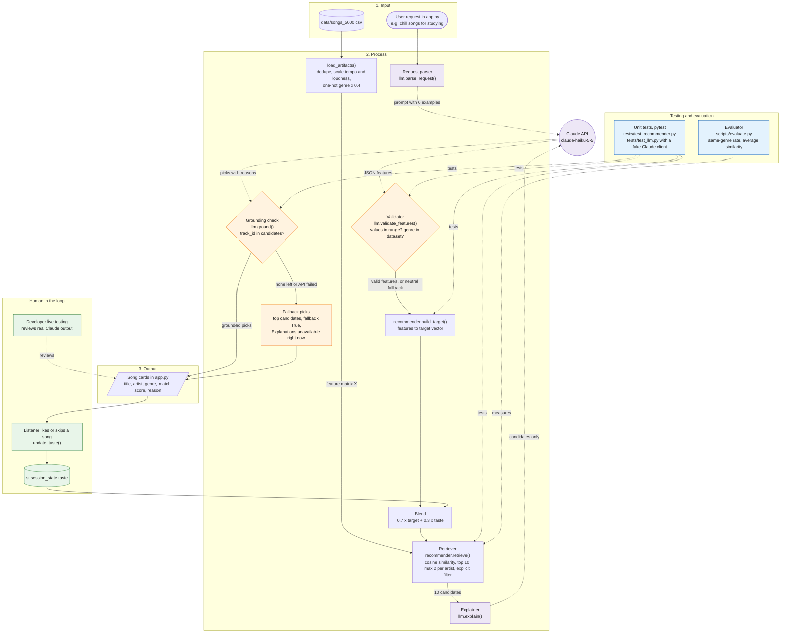

# Architecture

System overview of the RAG music recommender. Names match the code in
`app.py`, `src/recommender.py`, `src/llm.py`, `tests/` and `scripts/`.

More detailed diagrams:

- [Sequence diagram](sequence-diagram.md): one request, step by step,
  including the fallback path and like/skip feedback.
- [Class diagram](class-diagram.md): each module's public functions and
  the dependencies between them.

## System overview (components, data flow, checks)

Data moves top to bottom: **input** (the user's request and the song
dataset), **process** (parse, retrieve, explain, ground), then **output**
(song cards in the app). Dashed lines are calls to Claude. Dotted boxes on
the side show where results are checked:

- **Automated checks in the app:** `validate_features()` rejects
  out-of-range features or genres not in the dataset. `ground()` drops any
  song Claude names that isn't in the retrieved candidates.
- **Human checks:** the listener reads each reason and likes or skips the
  song, which updates the taste profile for the next request. The
  developer also reviews real Claude output during manual live testing.
  Nothing automated scores how good the explanations are, so this human
  review is the only check on their quality.
- **Testing:** pytest unit tests (Claude is replaced by a fake client) and
  `scripts/evaluate.py`, which scores retrieval on its own.

Colors: purple is the AI step, orange is an automated check, green is a
human, blue is testing.
