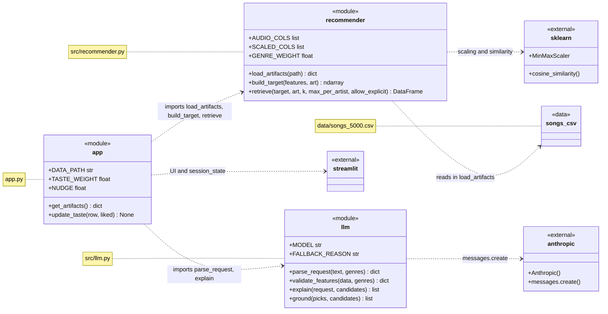

# Class Diagram: Modules and Dependencies

See [architecture.md](architecture.md) for the system overview.

Each module is drawn as a class with its public functions and main
constants. `llm.py` does not import `recommender.py`. `app.py` passes
the candidates DataFrame from `retrieve()` to `explain()`.

