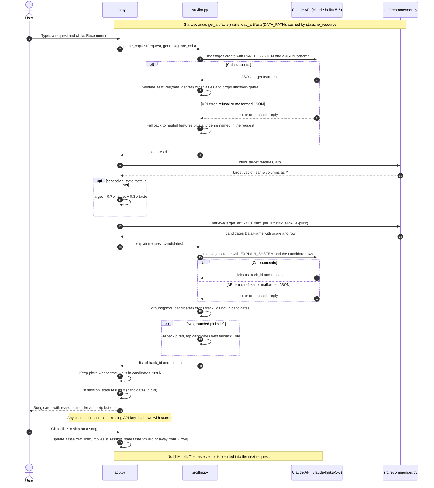

# Sequence Diagram: One Request

Names match the code in `app.py`, `src/llm.py` and `src/recommender.py`.
See [architecture.md](architecture.md) for the system overview.

`load_artifacts` runs once at startup and is cached with
`st.cache_resource`. Each request then goes through two Claude calls with
local retrieval in between. Like/skip feedback only updates
`st.session_state.taste` and makes no LLM call.

